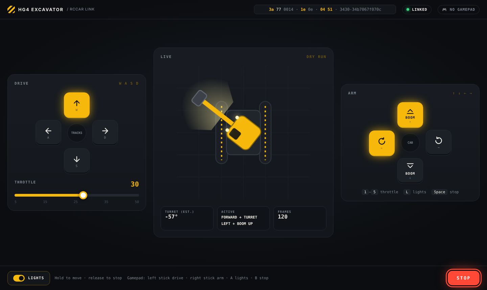

# Autonomous Excavator

Turning a Trasped 1:64 RC excavator (HG4-301/413 family, "2.4G remote + app" dual control) into an autonomous robot.

## Drive it

```bash
python3 ui/server.py
```

Open http://localhost:8000. Full step-by-step guide: [docs/03-control-panel-guide.md](docs/03-control-panel-guide.md).



## Phases

1. **Reverse engineer the app protocol** and control the excavator from an ESP32. Plan: [docs/01-reverse-engineering-plan.md](docs/01-reverse-engineering-plan.md)
2. **Control API** on the ESP32 (serial / Wi-Fi): `drive`, `swing`, `boom`, `arm`, `bucket`, `lights`.
3. **Autonomy stack**: iPhone overhead camera + ArUco markers, pose, go-to-point, dig/dump. Plan: [docs/04-autonomy-plan.md](docs/04-autonomy-plan.md)

## Repo layout

```
docs/      write-ups per phase
excavator/ protocol.py (frame builder), mac_ble.py (CoreBluetooth broadcaster)
ui/        server.py + index.html (control panel)
tools/     ble_sniff.py (laptop advert sniffer), parse_btsnoop.py (Android HCI log parser), esp32_ble_scanner
captures/  raw logs + session notes (what was pressed when)
```

## Status

- [x] Identify app + BLE mode (GATT vs advertising broadcast)
- [x] First capture (iPhone + Mac sniffer, no Android needed)
- [x] Frame format decoded (channels, neutral values, checksum)
- [ ] ~~APK decompiled~~ (not needed)
- [x] **Mac drives the excavator** (`tools/mac_rccar_tx.py`, worked first try, 2026-10-31)
- [ ] Confirm bucket down = 0x20
- [x] Python control API + web control panel (keyboard, touch, gamepad)
- [x] Throttle floor 15, throttle applies to turns, trim
- [ ] Overhead iPhone camera + ArUco pose (`tools/camera_check.py`, `docs/markers.pdf`)
- [ ] Go-to-point, then scripted dig/dump
