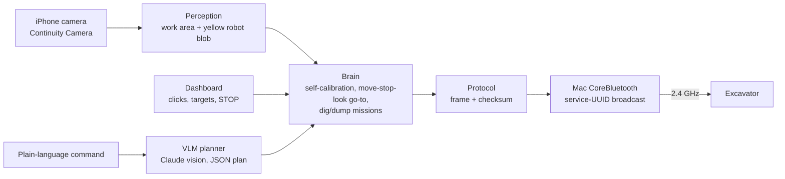

# Autonomous Excavator

Retrofitting autonomy onto an off-the-shelf toy excavator (Trasped 1:64, HG4-301/413 family) with no access to its electronics: reverse-engineered radio protocol, camera-only perception, self-calibration by active perception, and a supervised autonomy stack that digs at A and dumps at B.


## What it does

- **Controls the toy from a laptop.** The phone app's Bluetooth commands were reverse-engineered from over-the-air captures (no Android, no app decompiling). The Mac re-creates them and drives the excavator; it worked on the first try.
- **Sees it with an iPhone on the table**, at any angle, on any plain surface (a blanket works). No markers, no tape.
- **Calibrates itself.** At startup it drives forward, back and spins, watching itself, to learn heading, speed and turn rate.
- **Drives where you click, or where you say.** Click a spot or place targets A/B; or type "dig near the far corner, then dump next to B" and a vision-language model turns it into a plan that the navigation executes.
- **Runs a full mission**: go to A, dig, go to B, dump, repeat. With an e-stop, a deadman timeout and a bounded work area.

## How it works



| Layer | Approach |
|---|---|
| Protocol | Commands hide inside a 128-bit BLE service UUID the app advertises: `checksum, counter, 0x0014, speed A, speed B, flags, action bits, pairing ID`. Decoded from 3 labelled capture sessions; checksum verified on all 185 captured frames. [Details](docs/02-protocol-findings.md) |
| Work area | AUTO: the uniform region under the robot, in the camera's own view, scaled by the robot's known length. Or click 4 corners of a known rectangle for a true top-down homography in cm |
| Robot state | Largest yellow blob inside the work area. Front vs back from the arm (the blob is lopsided towards it); heading from a Kalman filter fusing actual motion, arm side and long axis, plus a learned turret offset |
| Control | Steers while driving with uneven track speeds (pure-pursuit style), spins only for large errors; spin rate re-identified online after every spin. Move, stop, look: robust to ~0.3 s camera + radio latency |
| Planner | Claude sees the camera image with a coordinate grid drawn on it and returns steps (`goto`, `dig`, `dump`, `set_target`). It never touches the motors; points outside the work area are rejected |
| Safety | STOP / Space halts instantly; 0.4 s deadman on manual control; every autonomous command has its own timeout |

## Results so far

| Test | Result |
|---|---|
| Replay of decoded frames from the Mac | Drove the excavator first try |
| Realistic simulator (fast spins, motor dead time, random track wiring), 30 robots x 3 goals | **90/90** goals (previous controller: 48/90, same "too many steps" failure as the real toy) |
| Same, turret 25° off centre / toy that ignores uneven tracks | 60/60 / 60/60 |
| Simulated missions (random start pose, random robot dynamics), metric mode | 11/11 complete, arrival error 0.4-3.5 cm |
| Simulated missions, camera-view mode (no rectangle, robot-size scale) | 6/6 complete |
| Click-placed targets from the dashboard, simulator | Complete, 1.0 cm at A, 3.5 cm at B |
| Real floor (blue blanket, iPhone camera) | Work area and robot detected. Full mission: in progress (see Known issues) |

## Quick start

```bash
git clone https://github.com/RaiPujol/autonomous-excavator.git
cd autonomous-excavator
pip install pyobjc-framework-CoreBluetooth opencv-contrib-python anthropic
```

| I want to | Run | Guide |
|---|---|---|
| Try everything without hardware | `python3 dashboard/server.py --sim` | [Autonomy guide](docs/04-autonomy-guide.md) |
| Drive the excavator manually | `python3 ui/server.py` | [Control panel guide](docs/03-control-panel-guide.md) |
| Run autonomy on the real toy | `python3 dashboard/server.py --cam 1` | [Autonomy guide](docs/04-autonomy-guide.md) |

Then open http://localhost:8000. Close the RCCar app on the phone first.

## Docs

1. [Reverse-engineering plan](docs/01-reverse-engineering-plan.md): options considered, why the app and not the 2.4 GHz remote
2. [Protocol findings](docs/02-protocol-findings.md): frame layout, checksum, command table, session logs
3. [Control panel guide](docs/03-control-panel-guide.md): manual driving, keyboard / touch / gamepad, trim
4. [Autonomy guide](docs/04-autonomy-guide.md): setup, dashboard, tuning, troubleshooting

## Repo layout

```
excavator/   protocol.py (frame builder), mac_ble.py (CoreBluetooth broadcaster)
autonomy/    vision.py, brain.py (calibration, navigation, missions), vlm.py, sim.py, config.py
dashboard/   autonomy dashboard (server + page)
ui/          manual control panel (server + page)
tools/       ble_sniff.py, decode_rccar.py (protocol capture), mac_rccar_tx.py, camera_check.py,
             parse_btsnoop.py (Android path), esp32_ble_scanner, esp32_rccar_tx (ESP32 sketches)
captures/    capture session notes
docs/        write-ups, images, archive/ (superseded marker-based plan)
```

## Known issues

- **Excavator switches off during autonomous runs.** Most likely a weak battery (3.7 V 200 mAh, ~20 min): autonomous mode starts the motors many times, and each start draws a current spike that can reset the toy's chip. Next test: full charge, then "gentle mode" (Settings: Min drive pulse 0.3 s, Min turn pulse 0.25 s) to see if fewer, longer pulses avoid it.
- **Turn speed on spins**: the toy seems to spin at its own speed whatever we send. The autopilot now copes (short capped spins, online rate estimate) and steers with the tracks instead where it can.
- **Arm hidden = no heading**: with the arm tucked in, the blob looks round from some angles. Drive in the travel pose (arm low, stretched out).
- **Bucket down = `0x20`** is inferred from the bit pattern, not captured.
- **Height bias**: the robot is ~5 cm tall, so from an angled camera it appears slightly further away than it is. Large targets absorb it; a correction is planned if it stops short.

## Roadmap

- [x] Decode the app protocol and drive from the Mac
- [x] Manual control panel (keyboard, touch, gamepad, trim)
- [x] Markerless perception, self-calibration, go-to, A→B mission, simulator
- [x] Surface-agnostic work area, click-placed targets, plain-language commands
- [ ] Full mission on the real floor + demo video + metrics (cycle time, success rate over 10 runs)
- [ ] ROS 2 nodes (camera, perception, planner, radio driver) with Foxglove visualisation
- [ ] Safety layer on the ESP32 in firmware (deadman, rate limits, e-stop), Mac sends commands over serial
- [x] Realistic simulator + headless regression test (`tests/sim_missions.py`)
- [ ] Obstacles: occupancy grid from the fixed camera, A* with inflated obstacles, blanket edge as a boundary
- [ ] Optional prior map from a phone 3D scan (iPhone 15 Pro LiDAR), aligned with the blanket corners
- [ ] Simulator missions as regression tests in CI
- [ ] Learned detector / keypoints trained on frames auto-labelled by the current pipeline
