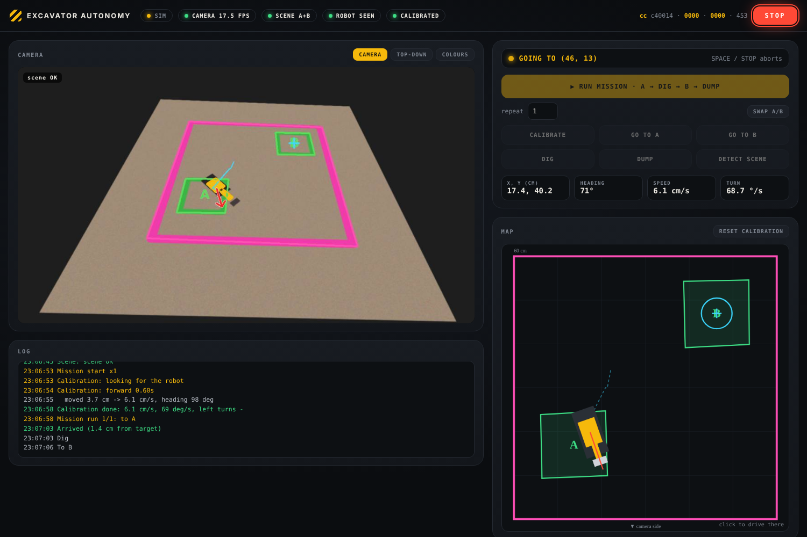
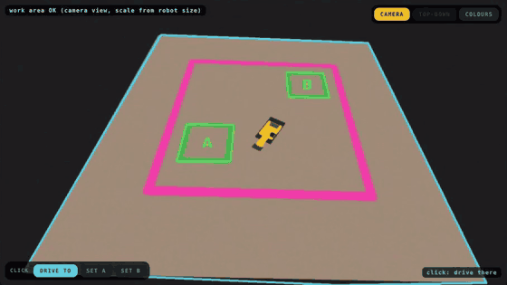
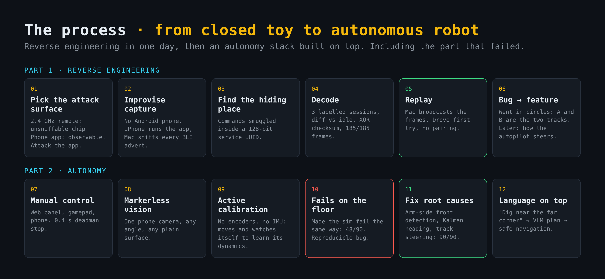
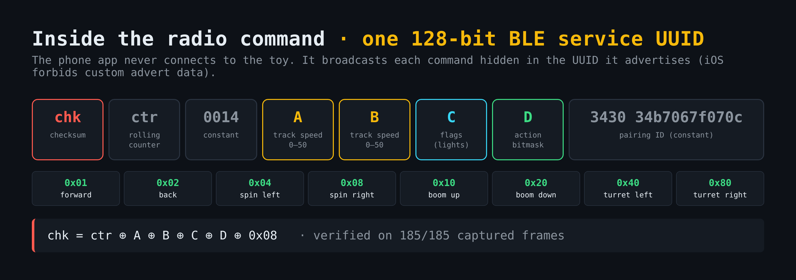
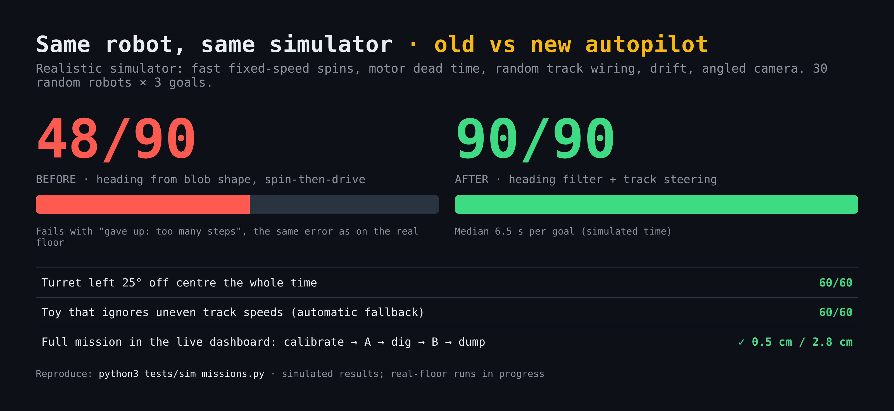
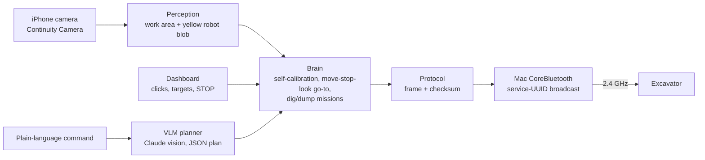

# Autonomous Excavator

I took a toy excavator off the shelf (Trasped 1:64, HG4-301/413 family) and made it autonomous **without opening it**. I reverse-engineered its radio protocol from over-the-air captures, then built a camera-only autonomy stack on top: perception, self-calibration, heading estimation, navigation and a language-driven mission planner.

The project has two halves. Each one stands on its own:

| | Part 1: Reverse engineering | Part 2: Autonomy |
|---|---|---|
| Problem | Closed toy, phone app, no docs, no access to the electronics | One phone camera, no markers, no encoders, no IMU, a toy that spins at its own speed |
| Result | Protocol decoded and replayed from a laptop **in one day**. Checksum verified on 185/185 captured frames. Drove the toy on the first try | Self-calibrating stack that finds the robot, learns how it moves, and runs dig-at-A / dump-at-B missions. **90/90** goals in a realistic simulator |
| Skills | BLE, packet analysis, protocol design, CoreBluetooth | Computer vision, state estimation (Kalman filter), system identification, control, simulation, VLM planning |



<p align="center"><br><em>Full mission in the simulator (4x speed): self-calibration, then A → dig → B → dump. Try it: <code>python3 dashboard/server.py --sim</code></em></p>

## The process



How it actually went, including what didn't work. Each step changed the next one.

### Part 1: Getting in without opening it

**1. Pick the attack surface.** The toy has two control paths: a 2.4 GHz remote and a phone app. The remote uses a cheap proprietary radio chip that none of my tools could sniff (ESP32, Flipper Zero). The app, though, has to talk through the phone's Bluetooth, and a phone can be observed. [Plan and options](docs/01-reverse-engineering-plan.md)

**2. Improvise the capture.** The textbook approach is Android's Bluetooth HCI snoop log, but I had no Android phone. Instead I ran the app on an iPhone and wrote a sniffer on the Mac ([`tools/ble_sniff.py`](tools/ble_sniff.py)) that logs every nearby Bluetooth advertisement. One device changed its payload 55 times while every other device stayed constant: the phone.

**3. Find where the commands hide.** The app never connects to the toy. It *broadcasts* each command, and the toy's 2.4 GHz receiver picks the broadcast up. iOS doesn't let apps put custom data in a broadcast, so the app smuggles the command inside the 128-bit **service UUID** it advertises:



```
chk ctr 0014 - A  B - C  D - 3430-34b7067f070c
 |   |         |  |   |  |   pairing ID (constant)
 |   |         |  |   |  action bits: fwd, back, left, right, boom up/down, turret L/R
 |   |         |  |   flags: lights
 |   |         track speeds A, B (0-50)
 |   rolling counter
 checksum = ctr ^ A ^ B ^ C ^ D ^ 0x08
```

**4. Decode with labelled experiments.** I ran three capture sessions, each changing one thing at a time (lights only, then every button labelled), and diffed each frame against idle. The XOR checksum matched all 185 frames. [Session logs](docs/02-protocol-findings.md)

**5. Replay.** The Mac rebuilds the frame and broadcasts it through CoreBluetooth ([`excavator/`](excavator/)). The excavator drove on the first try, with no pairing needed.

**6. A bug that turned into a feature.** Driving "forward" made it go in circles. The app always sent `B = A - 16`, which I first took for a derived value. The circles showed that A and B are **the two track speeds**. Sending A = B drives straight, and later in Part 2 sending A ≠ B became the way the autopilot steers.

### Part 2: Making it drive itself

**7. Manual control first.** A web control panel (keyboard, gamepad, phone touch) with a 0.4 s deadman stop. Driving it by hand showed how the toy behaves before automating it. [Control panel](docs/03-control-panel-guide.md)

**8. Markerless perception.** One iPhone on the table, any angle. The work area is the uniform surface under the robot (a blanket); the robot is the largest yellow blob on it, scaled by its known length. The first version needed a pink tape square and printed markers; I removed them so it works on any plain surface ([old plan](docs/archive/)).

**9. Calibration by active perception.** The robot has no encoders and no IMU, so it learns about itself by moving and watching: it drives forward and back, spins, and drives with uneven tracks. From that it learns its speed, spin rate, motor dead time, how much uneven tracks steer, and which track is which.

**10. It worked in simulation and failed on the floor.** Missions passed in the simulator, but the real toy drove in circles until it timed out. Rather than tune on the hardware, I made the simulator **fail the same way**: fast spins regardless of throttle, motor start delay, random track wiring, an angled camera. The old controller dropped to 48/90 goals there, with the same timeout error as the real toy. That gave me a reproducible bug.

**11. Fix the root causes.** The failure had two causes:
- *Heading.* The blob's long axis can't tell front from back and can read sideways. Fix: the arm sticks out only at the front, so the blob is lopsided towards it (third moment of the pixel distribution). A Kalman filter fuses that with actual motion and the long axis, learns the turret offset, and stops trusting the arm if it disagrees with motion. When unsure, the robot drives a short probe to re-measure.
- *Control.* Fast fixed-speed spins overshot a tight heading tolerance forever. Fix: steer while driving with uneven track speeds (pure-pursuit style), spin only for large errors, aim spins short, and re-identify the spin rate online after every spin.



Result: 90/90 goals, plus 60/60 with the turret 25° off centre and 60/60 for a toy whose tracks can't steer (automatic fallback). [`tests/sim_missions.py`](tests/sim_missions.py) runs it headless in under two minutes.

**12. A language interface on top.** Type "dig near the far corner, then dump next to B". Claude sees the camera image with a coordinate grid and returns a JSON plan. The planner never touches the motors: the navigation stack executes the plan, and STOP, timeouts and work-area bounds still apply.

### What I took from it

- **Attack the observable interface.** The phone's side of the link was easy to watch. The toy's radio wasn't.
- **Make the simulator fail like reality before fixing anything.** Tuning on hardware hides the cause, while a reproducible failure in sim makes it visible.
- **Fix estimation before control.** The robot circled because its heading was wrong, not because the controller was weak.

## What it does

- **Controls the toy from a laptop** by re-creating the app's Bluetooth broadcasts.
- **Sees it with an iPhone on the table**, at any angle, on any plain surface. No markers, no tape.
- **Calibrates itself** by moving and watching itself.
- **Drives where you click, or where you say**, and runs full missions: go to A, dig, go to B, dump, repeat. With an e-stop, a deadman timeout and a bounded work area.

## How it works



| Layer | Approach |
|---|---|
| Protocol | Commands hide inside a 128-bit BLE service UUID the app advertises: `checksum, counter, 0x0014, speed A, speed B, flags, action bits, pairing ID`. Decoded from 3 labelled capture sessions; checksum verified on all 185 captured frames. [Details](docs/02-protocol-findings.md) |
| Work area | AUTO: the uniform region under the robot, in the camera's own view, scaled by the robot's known length. Or click 4 corners of a known rectangle for a true top-down homography in cm |
| Robot state | Largest yellow blob inside the work area. Front vs back from the arm (the blob is lopsided towards it); heading from a Kalman filter fusing actual motion, arm side and long axis, plus a learned turret offset |
| Control | Steers while driving with uneven track speeds (pure-pursuit style), spins only for large errors; spin rate re-identified online after every spin. Move, stop, look: robust to ~0.3 s camera + radio latency |
| Planner | Claude sees the camera image with a coordinate grid drawn on it and returns steps (`goto`, `dig`, `dump`, `set_target`). It never touches the motors; points outside the work area are rejected |
| Safety | STOP / Space halts instantly; 0.4 s deadman on manual control; every autonomous command has its own timeout |

## Results so far

| Test | Result |
|---|---|
| Replay of decoded frames from the Mac | Drove the excavator first try |
| Realistic simulator (fast spins, motor dead time, random track wiring), 30 robots x 3 goals | **90/90** goals (previous controller: 48/90, same "too many steps" failure as the real toy) |
| Same, turret 25° off centre / toy that ignores uneven tracks | 60/60 / 60/60 |
| Simulated missions (random start pose, random robot dynamics), metric mode | 11/11 complete, arrival error 0.4-3.5 cm |
| Simulated missions, camera-view mode (no rectangle, robot-size scale) | 6/6 complete |
| Click-placed targets from the dashboard, simulator | Complete, 1.0 cm at A, 3.5 cm at B |
| Real floor (blue blanket, iPhone camera) | Work area and robot detected. Full mission: in progress (see Known issues) |

## Quick start

```bash
git clone https://github.com/RaiPujol/autonomous-excavator.git
cd autonomous-excavator
pip install pyobjc-framework-CoreBluetooth opencv-contrib-python anthropic
```

| I want to | Run | Guide |
|---|---|---|
| Try everything without hardware | `python3 dashboard/server.py --sim` | [Autonomy guide](docs/04-autonomy-guide.md) |
| Drive the excavator manually | `python3 ui/server.py` | [Control panel guide](docs/03-control-panel-guide.md) |
| Run autonomy on the real toy | `python3 dashboard/server.py --cam 1` | [Autonomy guide](docs/04-autonomy-guide.md) |

Then open http://localhost:8000. Close the RCCar app on the phone first.

## Docs

1. [Reverse-engineering plan](docs/01-reverse-engineering-plan.md): options considered, why the app and not the 2.4 GHz remote
2. [Protocol findings](docs/02-protocol-findings.md): frame layout, checksum, command table, session logs
3. [Control panel guide](docs/03-control-panel-guide.md): manual driving, keyboard / touch / gamepad, trim
4. [Autonomy guide](docs/04-autonomy-guide.md): setup, dashboard, tuning, troubleshooting

## Repo layout

```
excavator/   protocol.py (frame builder), mac_ble.py (CoreBluetooth broadcaster)
autonomy/    vision.py, brain.py (calibration, navigation, missions), vlm.py, sim.py, config.py
dashboard/   autonomy dashboard (server + page)
ui/          manual control panel (server + page)
tools/       ble_sniff.py, decode_rccar.py (protocol capture), mac_rccar_tx.py, camera_check.py,
             parse_btsnoop.py (Android path), esp32_ble_scanner, esp32_rccar_tx (ESP32 sketches)
captures/    capture session notes
docs/        write-ups, images, archive/ (superseded marker-based plan)
```


